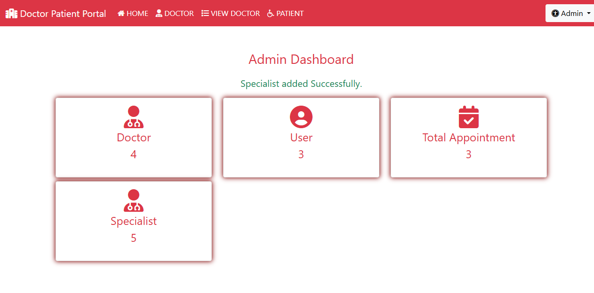
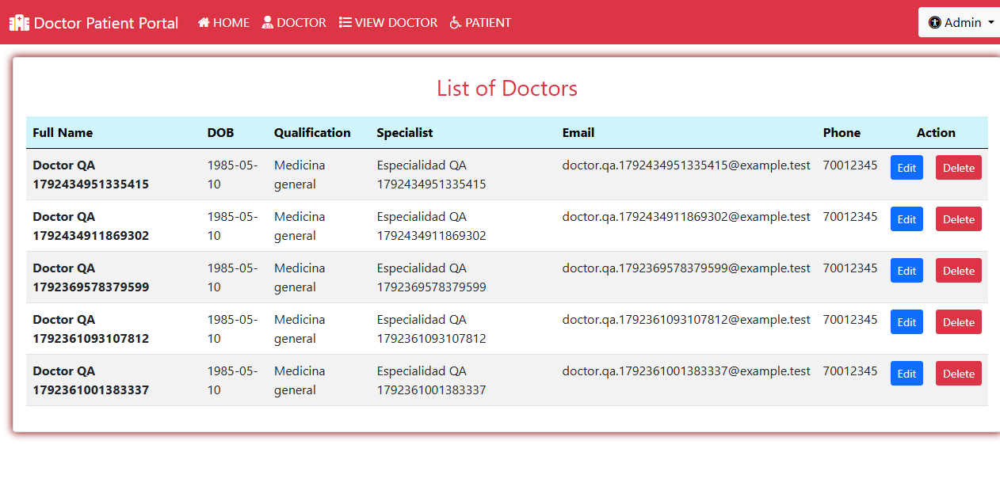

# Evidencia de ejecución — Persona 2

Fecha: 19 de octubre de 2026. Ambiente: portal local de práctica en `127.0.0.1:8080`, Tomcat 9, base `hospital` en contenedor `hospital-mysql`, Cypress 16.1.1 y Chrome 155 headless. Todos los nombres y correos de prueba son ficticios (`example.test`). No se usaron datos de pacientes reales.

## TC-03 y TC-04 en la rama `qa/admin-catalogo`

Comando: `npm run cy:smoke` desde `entrega-qa` del clon del fork.

Resultado observado: `TC-03` aprobado (panel y contadores visibles), `TC-04` aprobado (mensaje de acceso inválido y permanencia en login). Resumen Cypress: **2 passing, 0 failing, 1 pending**. El caso pendiente es el flujo largo `it.skip`; los tests de Personas 1 y 3 todavía no estaban integrados en `main` al crear esta rama.

## TC-07 y TC-08 en verificación aislada

Se ejecutaron los mismos pasos del bloque `PERSONA_2_ADMIN` mediante un spec Cypress temporal solo para verificar las altas sin esperar a la integración. El spec temporal se retiró antes del commit; no es parte del entregable de un único JS.

Comando: `npx cypress run --browser chrome --spec cypress/e2e/admin_verificacion_temporal.cy.js`.

Resultado observado: **1 passing, 0 failing**. Se creó la especialidad ficticia `Especialidad QA 1792434951335415` y el doctor ficticio `Doctor QA 1792434951335415` con `doctor.qa.1792434951335415@example.test`. Se mostró la confirmación de especialidad, el selector aceptó esa especialidad, se mostró la confirmación de doctor y la fila del doctor apareció en el listado.

La suite funcional integrada queda pendiente hasta que el equipo fusione los bloques de paciente y cita y la Persona 4 active el flujo largo. No atribuir a este PR una ejecución integrada que aún no ocurrió.
