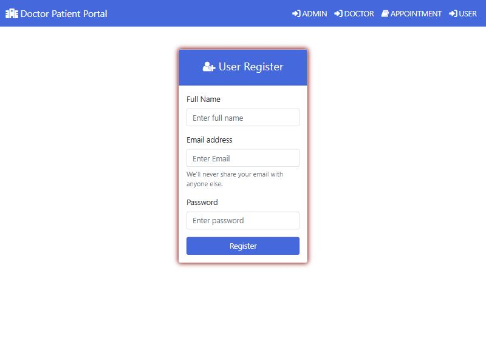
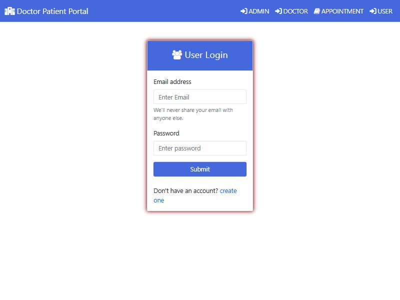
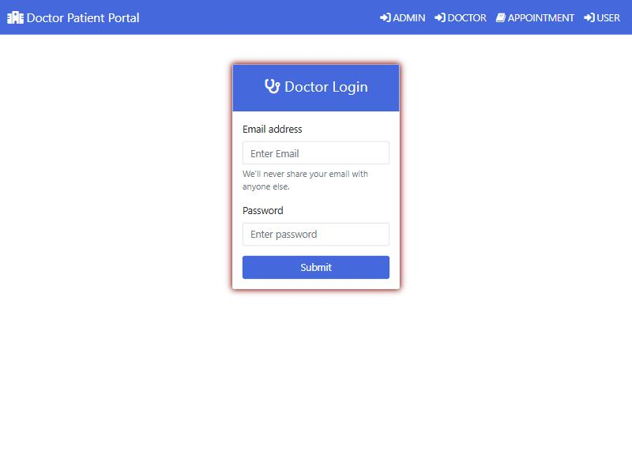
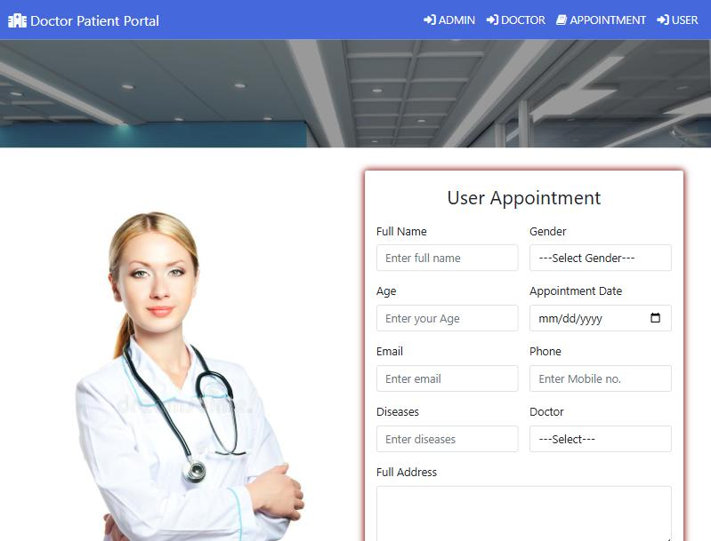
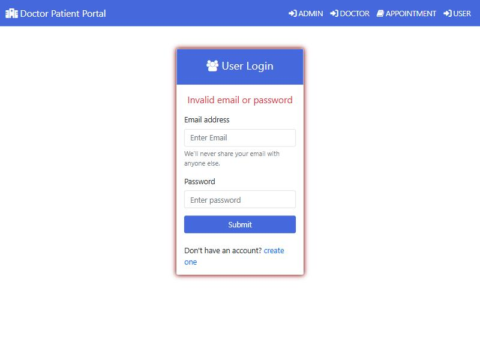
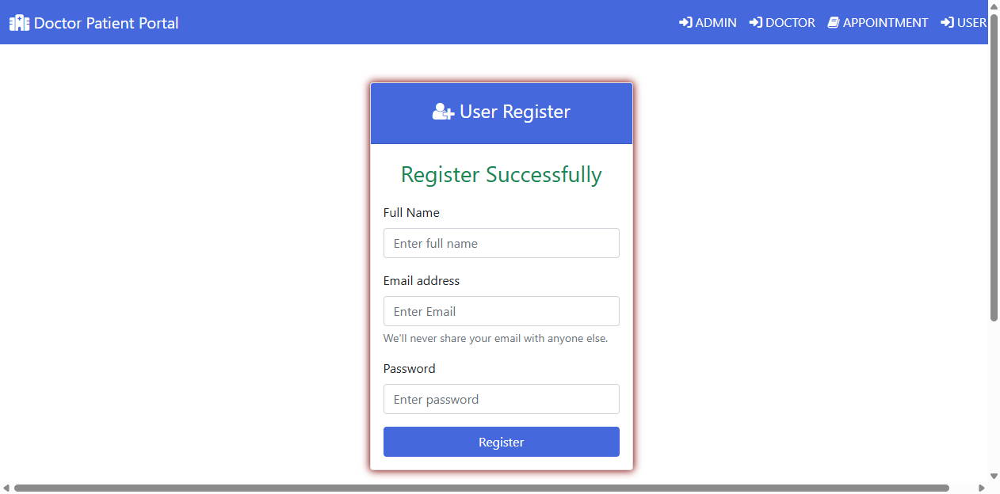
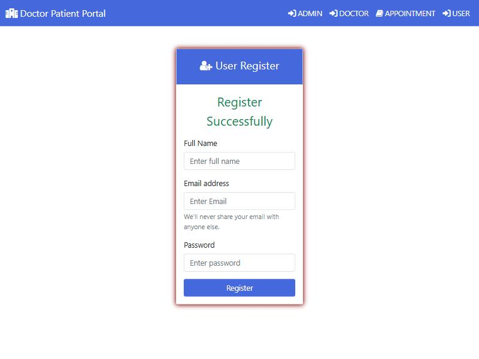

# Evidencia de ejecución — Persona 3

Fecha: 19 de octubre de 2026. Ambiente: portal local de práctica en `127.0.0.1:8080`, Tomcat 9 (JDK 21) y MySQL 8.4 en Docker (`hospital-mysql`, base `hospital`), Cypress 16.1.1 y Chrome 155 headless. Todos los nombres y correos de prueba son ficticios (`example.test`). No se usaron datos personales reales.

## Cypress en la rama `qa/pacientes`

Con los tres bloques `PERSONA_3` pegados en `cypress/e2e/portal_hospital.cy.js` (15:37, America/La_Paz):

| Comando | Resultado observado | Nota |
| --- | --- | --- |
| `npm run cy:smoke` | **1 passing, 0 failing, 2 pending** | TC-02 aprobado. TC-06 y el flujo largo se omiten en modo smoke. Los tests de Personas 1 y 2 aún no están en `main`. |
| `npm run cy:full` | **2 passing, 0 failing, 1 pending** | TC-02 y TC-06 aprobados. El pendiente es el flujo largo `it.skip`, que activará la Persona 4. |

## TC-02 interactiva en navegador

Se abrieron las cuatro páginas en un navegador Chromium (15:38). Cada una mostró su formulario sin error de servidor: `User Register`, `User Login`, `Doctor Login` y `User Appointment`. Estado: **Aprobado**.

## TC-06 interactiva en navegador

En `user_login.jsp` se ingresó `inexistente.manual01@example.test` con una contraseña incorrecta (15:39). La página permaneció en `user_login.jsp` y mostró `Invalid email or password`. Estado: **Aprobado**.

## TC-05 en verificación aislada (automática)

El bloque `PERSONA_3_REGISTRO` vive dentro del flujo largo `it.skip`, por lo que no se ejecuta en esta rama. Se ejecutaron los mismos pasos mediante un spec Cypress temporal; el spec se retiró antes del commit y no forma parte del entregable de un único JS.

Comando: `npx cypress run --browser chrome --spec cypress/e2e/pacientes_verificacion_temporal.cy.js`.

Resultado observado (15:31, America/La_Paz): **1 passing, 0 failing**, 3 segundos. Identificador ficticio del run: `1792438296795133`.

- Se registró `Paciente QA 1792438296795133` con `paciente.qa.1792438296795133@example.test` y se mostró `Register Successfully`.
- El inicio de sesión redirigió a `index.jsp` y el menú de usuario mostró el nombre del paciente.
- Consulta en MySQL: `user_details` contiene la fila `id = 1` con ese nombre y correo.

Esto comprueba la funcionalidad local, pero **no** equivale a una ejecución del flujo largo integrado.

## TC-05 interactiva en navegador (sin Cypress)

Ejecución paso a paso en un navegador Chromium, escribiendo en los formularios y pulsando los botones, sin script de Cypress. Hora: 15:34–15:35 (America/La_Paz). Datos ficticios: `Paciente QA Manual 01`, `paciente.qa.manual01@example.test`.

| Paso | Esperado | Observado | Estado |
| --- | --- | --- | --- |
| Abrir `signup.jsp`, completar nombre, correo y contraseña, pulsar `Register` | Mensaje `Register Successfully` | Se mostró `Register Successfully` y el formulario quedó vacío | Aprobado |
| Abrir `user_login.jsp`, iniciar sesión con el mismo correo y contraseña | Portada con el nombre del paciente | Redirigió a `index.jsp`; el menú de usuario mostró `Paciente QA Manual 01` | Aprobado |
| Consultar `user_details` en MySQL | Fila del paciente | Fila `id = 2` con el nombre y correo usados | Aprobado |

Se cerró la sesión con `userLogout` al terminar. No se observaron defectos.

