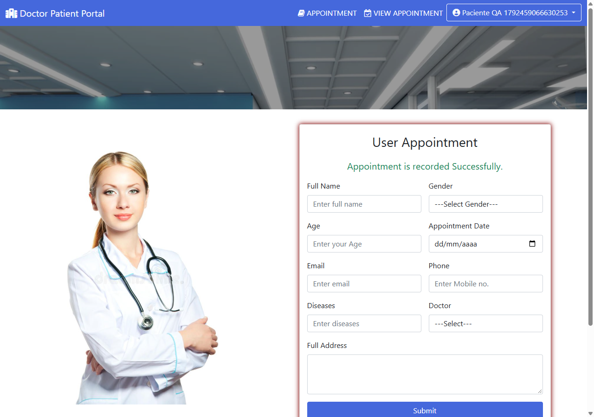
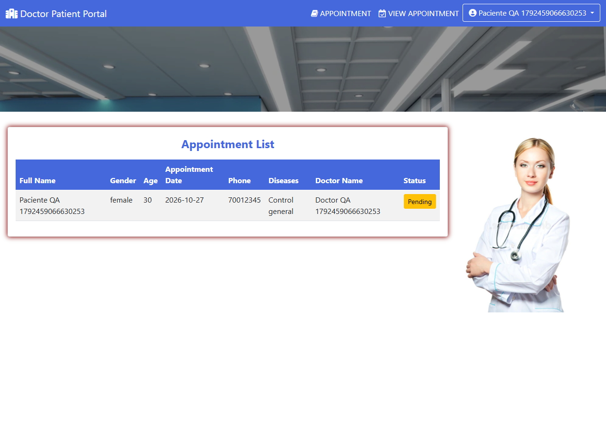
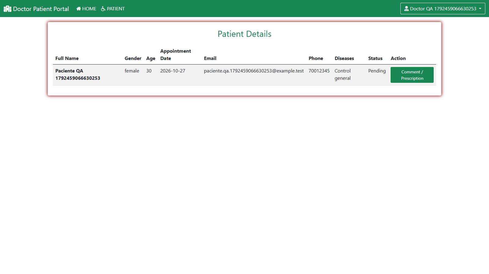
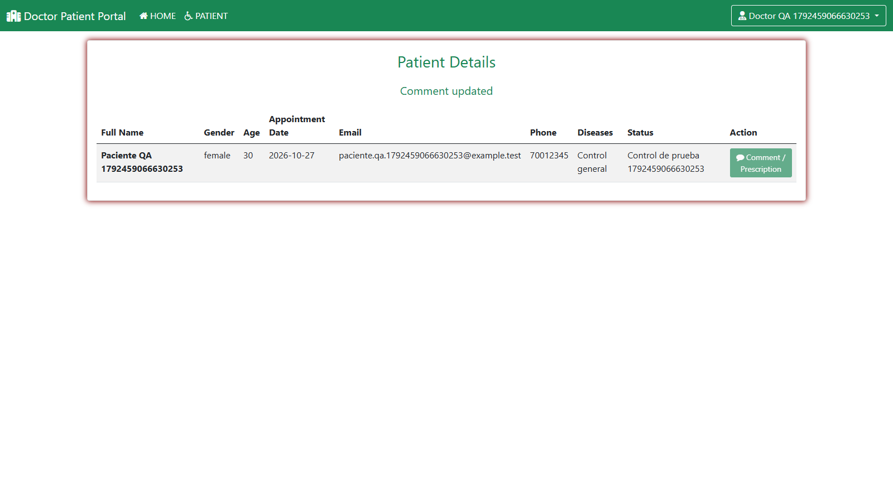

# Ejecución de Persona 4

## Identificación y ambiente

- Responsable del aporte: `Chucharizard` (Chucho, nombre del perfil GitHub).
- Ejecución asistida por Codex el 19 de octubre de 2026, aproximadamente 21:17–21:18, America/La_Paz.
- Rama: `qa/citas-doctor`, creada desde `main` con los PR #1, #2 y #3 integrados; base `8baac8a641b66e6e51e1e1f4e8efd96b9d5af6bb`.
- Commit del código ejecutado: `aab4ce7d9a2913583a04ad6ae0ad35c9afbdfc7d`. Los commits posteriores de documentación y evidencia no cambian este código.
- SHA256 del spec: `899307180f28b382b79dc248c471ac1751422194099e3f39df83f2a8cc0e427b`.
- Windows, Java OpenJDK 17.0.20, Tomcat 9.0.123, Node.js 24.19.0, Cypress 16.1.1 y Chrome 155 headless.
- URL: `http://127.0.0.1:8080/Doctor-Patient-Portal/`.
- Base local nueva de práctica: `hospital`, MariaDB 11.4.8 portátil en `127.0.0.1:3306`, usando el conector MySQL del proyecto.

## Resultados observados

| Comando | Aprobados | Fallidos | Pendientes | Duración del spec |
| --- | ---: | ---: | ---: | --- |
| `npm run cy:smoke` | 4 | 0 | 2 funcionales omitidos por el modo smoke | 5 s |
| `npm run cy:full` sobre el código final | 6 | 0 | 0 | 11 s |

Las salidas completas están en [smoke](cypress-smoke.txt) y [suite completa](cypress-full.txt). El smoke se ejecutó antes del ajuste de tamaño de ventana para las capturas; la suite final vuelve a ejecutar y aprobar los cuatro smoke con la configuración final. Además se comprobó el smoke con Electron 146: 4 aprobados y 0 fallidos.

Los seis tests son cuatro smoke, TC-06 y un único recorrido secuencial TC-05/07/08/09/10. Se ejecutaron las aserciones de cada etapa del recorrido; no son diez tests independientes de Cypress.

## TC-09 reserva y consulta de cita

Datos ficticios: `Paciente QA 1792459066630253`, `paciente.qa.1792459066630253@example.test`, doctor `Doctor QA 1792459066630253`, fecha `2026-10-27`, género femenino, edad 30, teléfono 70012345, motivo Control general y dirección Calle de prueba 123.

Pasos ejecutados por Cypress: iniciar sesión paciente, completar el formulario, seleccionar el doctor, enviar y abrir el listado de citas.

Esperado y observado: se mostró `Appointment is recorded Successfully.` y el listado presentó la fila del paciente con el doctor elegido, fecha de cita y estado `Pending`. Resultado: **Aprobado en ejecución automática**.





## TC-10 atención del doctor

Pasos ejecutados por Cypress: iniciar sesión con el doctor creado, abrir Patient Details, comprobar paciente, correo, fecha y estado inicial; abrir Comment / Prescription, comprobar que el formulario pertenece al paciente y guardar `Control de prueba 1792459066630253`.

Esperado y observado: se mostró `Comment updated`, el comentario sustituyó a `Pending` y el enlace de comentar pasó a tener clase `disabled`. Tras recargar, el comentario y la clase `disabled` permanecieron. Resultado: **Aprobado en ejecución automática**.

Identificador de cita final: `4`. Identificador del run: `1792459066630253`. Los datos sin contraseñas están en [datos de ejecución](datos-ejecucion.json). El JSON se genera durante el recorrido y debe interpretarse junto con la salida final de Cypress.





Las cuatro capturas se revisaron visualmente. No se realizó una ejecución manual independiente: las acciones anteriores son automáticas y asistidas por Codex. No se usaron datos de personas reales. Durante el ajuste de las capturas se repitió el recorrido: se conservan cuatro conjuntos ficticios en la base; el run documentado corresponde a la cita 4.

## Desviaciones del ambiente y reproducción

Docker Desktop falló al iniciar por un socket local inaccesible. Para completar esta ejecución se utilizó MariaDB portátil. Esta prueba no sustituye una validación sobre MySQL 8; el integrador debe repetir smoke y suite completa en el ambiente acordado después del merge.

El despliegue local parte del código de la aplicación incluido en el fork. Para ejecutarlo en Tomcat 9 se aplicaron únicamente estos ajustes a una copia de despliegue, fuera del repositorio del aporte:

1. Descriptor Servlet 4.0 y retirada de la referencia a la clase inexistente `myuserServlet`, conservando el servlet existente.
2. Rutas de inclusión de `component/allcss.jsp` corregidas en `user_appointment.jsp` y `view_appointment.jsp`.
3. Compilación con Java 17 y opciones Maven de source/target 8 y UTF-8.

El [parche del despliegue](ajustes-entorno-local.patch) reproduce los dos primeros ajustes sobre la aplicación del fork. `git apply --unidiff-zero --check` lo verificó sin modificar los fuentes del clon. El [esquema de práctica](schema-practica.sql) conserva el orden de columnas que leen los DAO; requiere crear primero una base vacía `hospital`. El parche y el SQL se adjuntan como evidencia del ambiente, no se aplicaron a los archivos Java/JSP del PR.

El binario portátil se descargó del [archivo oficial de MariaDB](https://archive.mariadb.org/mariadb-11.4.8/winx64-packages/), verificando SHA256 `ed86e93157af46317bb49161451c2ec258498a6fa8e68ca821ef1d780d855e6b`.

Desde una copia de despliegue con el parche aplicado y la base iniciada:

```powershell
mvn -B -f Doctor-Patient-Portal/pom.xml -Dmaven.compiler.source=8 -Dmaven.compiler.target=8 -Dproject.build.sourceEncoding=UTF-8 package
# Desplegar el WAR resultante en Tomcat 9 bajo el contexto Doctor-Patient-Portal.
# Desde entrega-qa del fork:
npm ci
npx cypress install
npm run cy:smoke
npm run cy:full
```

No se observaron defectos funcionales en TC-09/TC-10 en este ambiente. La diferencia MariaDB/MySQL y los ajustes locales de despliegue quedan declarados para la revisión e integración del equipo.
